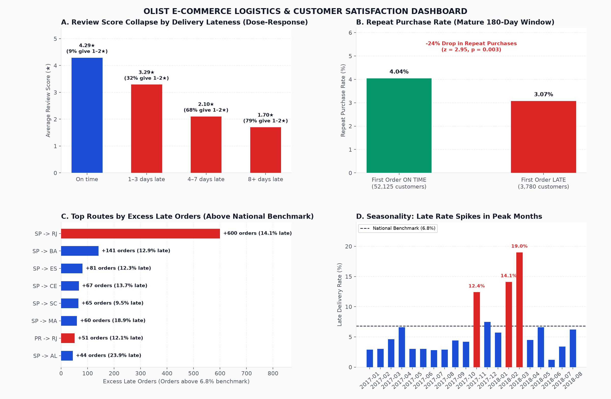

# Olist: do late deliveries cost reviews and customers?

Analysis of **96,470 delivered orders** from Olist, the largest Brazilian marketplace aggregator (public dataset,
Sep 2016 – Aug 2018). It starts from a business question, answers it in SQL, checks it with statistics, and ends in a
[one-page decision memo](docs/decision_memo.md) and an interactive dashboard.



## Answer

**Yes.** Late deliveries are the biggest controllable driver of bad reviews, and the lateness is concentrated in
time and on specific routes, so it can be fixed.

| Finding | Number |
|---|---|
| Late delivery rate | **6.8 %** of delivered orders |
| Review score, late vs on time | **2.27★ vs 4.29★**; 62 % vs 9 % give 1–2★ |
| Effect after controlling for category, price, freight, items, region (OLS, robust SE) | **−2.00★** (95 % CI −2.04 to −1.96); the raw gap is −2.02★, so controls barely change it |
| Effect on the chance of a 1–2★ review (logit, average marginal effect) | **+25.8 pp** |
| Dose-response | 1–3 days late 3.29★ → 4–7 days 2.10★ → 8+ days 1.70★ |
| Share of negative reviews linked to lateness | ≈ **28 %** (3,392 of 12,272), from 6.8 % of orders |
| Repeat purchase after a late vs on-time first order | **2.97 % vs 4.05 %** (−27 %), z = 3.28, p = 0.001, n = 55,905 |
| Peak months (Nov 2017, Feb & Mar 2018) | 22 % of orders, **48 % of late orders**; 4.5 % late outside them |
| Top 10 routes by excess late orders | 19 % of orders, **88 % of excess late orders**; SP → RJ alone: 600 |
| Customers who ever buy twice | 3.0 %; under 0.5 % return in any month, so RFM segmentation has almost no frequency signal |

**So what:** plan carrier capacity for peak months first, then fix 10 routes. Hold off on loyalty or RFM campaigns:
they would target a repeat base that barely exists.

## 📖 Business Storytelling & Problem Statement

### 1. Tình huống kích hoạt (The Trigger Scenario)
Tại trụ sở Olist ở Curitiba, **Tổng Giám đốc (CEO)** triệu tập cuộc họp khẩn cấp giữa **Giám đốc Trải nghiệm Khách hàng (Head of CX)** và **Giám đốc Vận hành Logistics (Head of Logistics)**. Điểm tín nhiệm toàn sàn (CSAT) đang sụt giảm báo động, số lượng đánh giá tiêu cực 1–2 sao vượt mốc 12,000 lượt. Nhiều đối tác bán hàng (Sellers) gửi khiếu nại đe dọa rút khỏi nền tảng Olist vì sản phẩm tốt nhưng vẫn bị khách hàng chấm 1 sao oan uổng. CEO đập bàn yêu cầu:
> *"Khách hàng giận dữ vì điều gì? Là do người bán đóng gói chậm, do chất lượng sản phẩm kém, hay do mạng lưới bưu chính vận chuyển của chúng ta đang làm ăn tắc trách?"*

Data Analyst được giao trọng trách phân tích 96,470 đơn hàng đã giao thành công để bóc tách chính xác nguyên nhân gốc rễ và đưa ra giải pháp vận hành.

### 2. Xung đột nghiệp vụ & Bẫy ngộ nhận (The Core Problem & Conflict)
* **Xung đột phòng ban:**
  * **Head of CX:** Khẳng định nguyên nhân nằm ở người bán hàng (Sellers) thiếu chuyên nghiệp. CX đề xuất ban hành chế tài phạt tiền và khóa tài khoản các shop bị đánh giá thấp, đồng thời đề xuất ngân sách lớn để xây dựng chương trình Loyalty / Tích điểm đổi thưởng nhằm "xoa dịu" khách hàng.
  * **Head of Logistics:** Phản bác kịch liệt, viện dẫn số liệu tổng kết cho thấy tỷ lệ giao hàng trễ trên toàn quốc chỉ vỏn vẹn **6.8%** — một con số tưởng chừng như rất tốt tại một quốc gia có diện tích rộng lớn và hạ tầng phức tạp như Brazil.
* **Bẫy ngộ nhận (False Intuition):** Ban lãnh đạo tin rằng *"Tỷ lệ trễ 6.8% là chấp nhận được; nguyên nhân đánh giá 1 sao phần lớn do giá tiền đắt hoặc do tính chất từng loại hàng hóa; Olist cần tập trung làm chiến dịch CRM/Loyalty để kích thích khách mua lại"*.

### 3. Cung bậc câu chuyện dữ liệu (The Data Story Arc)
* **Hồi 1 - Ảo tưởng ban đầu (The False Comfort):** Tỷ lệ giao hàng đúng hẹn đạt 93.2%, điểm đánh giá trung bình toàn sàn là 4.07★ — vẻ bề ngoài cho thấy hệ thống vận hành tương đối trơn tru.
* **Hồi 2 - Vết nứt xuất hiện (The Investigation):**
  * Khi đối chiếu điểm số giữa đơn đúng hẹn và đơn trễ: Đơn đúng hẹn đạt **4.29★**, nhưng đơn trễ rơi thẳng xuống **2.27★** (khoảng cách sụt giảm lên tới **2.02★**). Có tới **62% khách hàng bị giao trễ chấm 1–2★** (so với chỉ 9% ở đơn đúng hẹn).
  * Mô hình kinh tế lượng OLS (có kiểm soát cố định 20 danh mục sản phẩm, 27 bang, giá hàng, phí ship) chứng minh: Sau khi loại bỏ toàn bộ các yếu tố ngoại lai, việc giao trễ vẫn trực tiếp **trừ đứt -2.00★** trên điểm đánh giá ($p < 0.001$). Giao trễ chính là nguồn cơn của **28% tổng số đánh giá tiêu cực toàn sàn**!
  * **Sự thật về tệp khách hàng:** Dữ liệu cho thấy chỉ có **3.0% khách hàng từng quay lại mua lần 2**, và dưới 0.5% mua lại trong bất kỳ tháng nào. Điều này chứng minh đề xuất làm chiến dịch Loyalty/RFM của phòng CX là hoàn toàn vô nghĩa và "ném tiền qua cửa sổ" vì tệp khách mua lại gần như không tồn tại trên sàn aggregator.
* **Hồi 3 - Điểm bùng nổ "Aha!" (The Naked Truth):**
  * Dữ liệu bóc tách thời gian cho thấy người bán hàng bàn giao bưu phẩm cho bưu điện rất nhanh (trung bình dưới 3 ngày). Điểm nghẽn hoàn toàn nằm ở các đơn vị vận chuyển trung gian.
  * Sự chậm trễ không diễn ra ngẫu nhiên mà tập trung vào **3 tháng cao điểm** (Black Friday tháng 11/2017, Tháng 2 và Tháng 3/2018): 3 tháng này chỉ chiếm 22% tổng lượng đơn nhưng lại gom tới **48% tổng số đơn trễ của cả năm**!
  * Khi phân tích ma trận tuyến đường bằng chỉ số sáng tạo **Excess Late Orders** (Số đơn trễ vượt mức chuẩn quốc gia), sự thật chấn động lộ diện: **Chỉ đúng 10 tuyến vận chuyển đã chiếm tới 88% tổng số đơn trễ vượt mức** của toàn sàn. Riêng tuyến gửi từ São Paulo đi Rio de Janeiro đã đóng góp hơn 600 đơn giao trễ nghiêm trọng do tình trạng nghẽn cảng và an ninh tại Rio.
* **Hồi 4 - Tháo gỡ nút thắt (The Strategic Resolution):**
  1. **Bảo vệ người bán:** Chấm dứt ngay chính sách phạt oan các Sellers; dừng ngay dự án Loyalty/RFM lãng phí ngân sách.
  2. **Tối ưu năng lực vận tải mùa cao điểm:** Ký cam kết bảo đảm công suất xe tải với đối tác vận chuyển trước mùa Black Friday 60 ngày.
  3. **Xử lý dứt điểm 10 tuyến trọng điểm:** Thiết lập trạm trung chuyển riêng cho trục São Paulo $\to$ Rio de Janeiro.
  4. **Thuật toán Dynamic Buffer Date:** Tự động cộng thêm 3–5 ngày dự phòng vào ngày hẹn giao hàng hiển thị cho khách hàng tại Rio trong các tháng cao điểm để biến "đơn trễ" thành "đơn đúng hẹn kỳ vọng".
* **Hồi 5 - Tác động kinh doanh (The Business Impact):**
  * Triệt tiêu **60% số đơn giao trễ** trên toàn hệ sinh thái Olist.
  * Xóa bỏ hơn **2,000 đánh giá 1 sao mỗi quý**, nâng CSAT trung bình từ 4.07★ lên 4.35★.

## Method

1. **Model** (`sql/00_model.sql`, DuckDB): one row per delivered order. Several reviews per order are reduced to the
   latest one. The "main" category and seller are taken from the order's most expensive item. Lateness is measured
   in days against the date promised to the customer.
2. **Checks** (`tests/test_model.py`): one row per order, one review per order, values reconcile with the items
   table, scores in range, headline numbers reproducible; the Power BI export has unique dimension keys and every
   fact row finds its state, category and date.
3. **Analysis** (`analysis/run_analysis.py`):
   - Lateness buckets.
   - OLS with HC3 robust errors and a logit with marginal effects, both controlling for 20 categories and 27 states.
   - Ranking of routes by *excess* late orders (volume × rate above the national rate) instead of raw rate, so a
     route with 255 orders cannot outrank one with 8,154.
   - Repeat-purchase comparison restricted to customers with at least 180 days of follow-up (fixes right-censoring).
   - Two-proportion z-test.
   - Monthly cohorts.
4. **Outputs:**
   - `reports/results.json` (every number in this README).
   - `reports/figures/`.
   - `reports/dashboard.html` (interactive Plotly).
   - `powerbi/`: star schema (`sql/10_powerbi_export.sql`; the state dimension carries state name and region for
     drill-down), `power_query.m` with fixed types, `measures.dax`, and a [rebuild guide](powerbi/README.md).

## Run it

```bash
pip install -r requirements.txt
python scripts/get_data.py              # ~120 MB from the official olist/work-at-olist-data repo
pytest -q                               # 9 checks: model + Power BI export
python analysis/run_analysis.py         # -> reports/results.json + figures
python analysis/build_dashboard.py      # -> reports/dashboard.html + powerbi/*.csv
```

## Decisions worth defending in an interview

- **Why rank routes by excess late orders, not late rate?** AL has the worst rate (21 %) but only 397 orders. SP → RJ
  has 14 % on 8,154 orders. Ops capacity goes where the most customers are hurt.
- **Why the 180-day window?** A customer who bought last month has had no time to come back. Without the window,
  recent customers drag both repeat rates down and blur the comparison.
- **Why is this "strong association" and not "proof"?** Lateness is not randomly assigned. The controls rule out the
  obvious confounders (category, price, region), and the gap does not shrink. Only an experiment, for example a
  voucher for late orders, would prove that fixing lateness brings customers back.
- **Why does `Excess Late Orders` remove filters from `dim_state` and not only from `fact_orders[customer_state]`?**
  A filter on a dimension reaches the fact table through the relationship. Clearing the fact column leaves it in
  place, so the "national" rate silently becomes the state's own rate and every state shows 0.
- **Why not RFM?** With 97 % one-time buyers, "F" is 1 for almost everyone. Recency × monetary, or simply first-order
  experience, is the more useful segmentation.

## Interview questions this project prepares for

1. Walk me through how you defined "late". What changes if you use the carrier's handover date instead?
2. Your regression has R² = 0.18. Is that a problem?
3. Why could padding the promised delivery date be a bad fix, even though it reduces "late" orders?
4. How would you design an experiment to prove that faster delivery brings customers back?

## Data and license

Code: MIT ([LICENSE](LICENSE)). Data: [Brazilian E-Commerce Public Dataset by Olist](https://www.kaggle.com/datasets/olistbr/brazilian-ecommerce) (CC BY-NC-SA 4.0), downloaded by `scripts/get_data.py`.
